# RAKSHA-NET Architecture

> **Emulated Testbed** — PDPM IIITDM Jabalpur — Sovereign Technology for India  
> All layers are emulated/simulated unless marked ✅ IMPLEMENTED.

---

## System Diagram (Mermaid)

```mermaid
graph TB
    subgraph L5["Layer 5: Adaptive Security"]
        SEC["SecurityEngine\nML-KEM-768 / AES-256-GCM\nHKDF + ML-DSA-65 signing\n✅ REAL liboqs-ML-KEM-768 on WSL2\nHYBRID_CHACHA: X25519+ML-KEM-768\nRekey: ~0.75-4.87ms wall-clock"]
        QKD["QKD Interface\n🔶 SIMULATED ONLY\n(future upgrade path)"]
    end

    subgraph L4["Layer 4: AI Routing & Trust Engine"]
        ANOM["AnomalyEngine\nHeuristicDetector ✅\nGraphSAGE fallback ✅\nAICOP GraphSAGE 🔶 pluggable"]
        TRUST["TrustEngine\nEWMA weighted trust\n✅ IMPLEMENTED"]
        ROUTE["RouteEngine\nWeighted score + hysteresis\n✅ IMPLEMENTED"]
    end

    subgraph L3["Layer 3: LEO Satellite Mesh"]
        LEO1["LEO-1\n10.10.2.x / 10.10.4.x\n✅ Emulated (docker + netem)"]
        LEO2["LEO-2\n10.10.3.x / 10.10.5.x\n✅ Emulated (docker + netem)"]
    end

    subgraph L2["Layer 2: Edge Gateway"]
        GW["Gateway Node\nAI+Security Controller\n✅ IMPLEMENTED\nRoute switching: ip route replace"]
    end

    subgraph L1["Layer 1: Tactical Edge"]
        A["Node A\nGround Soldier\n10.10.1.2"]
        B["Node B\nUAV / Air Node\n10.10.4.3 / 10.10.5.3"]
    end

    subgraph L0["Layer 0: Core Network (Open5GS/srsRAN)"]
        CORE["Open5GS Core + srsRAN gNB\n🔶 Integration hook only\n(see docs/OPEN5GS_ATTACH.md)"]
    end

    A -->|"A-GW\n10.10.1.x"| GW
    GW -->|"GW-LEO1\n10.10.2.x"| LEO1
    GW -->|"GW-LEO2\n10.10.3.x"| LEO2
    LEO1 -->|"LEO1-B\n10.10.4.x"| B
    LEO2 -->|"LEO2-B\n10.10.5.x"| B
    CORE -->|"UE traffic\naccess net 10.10.9.x"| A

    GW --- ANOM
    ANOM --> TRUST
    TRUST --> ROUTE
    ROUTE --> GW
    GW --- SEC
    SEC --- QKD

    style L5 fill:#1e1b4b,stroke:#8b5cf6
    style L4 fill:#0c2340,stroke:#3b82f6
    style L3 fill:#0d2618,stroke:#22c55e
    style L2 fill:#1a1a0a,stroke:#f59e0b
    style L1 fill:#0f172a,stroke:#64748b
    style L0 fill:#1a0a0a,stroke:#ef4444
```



---

## Module Interfaces

### `common/interfaces.py`
Central data contracts — **do not rename public fields** without updating all consumers.

| Type | Fields | Producer | Consumer |
|------|--------|----------|----------|
| `LinkTelemetry` | link_id, t_ms, latency_ms, jitter_ms, loss, throughput_mbps, queue_depth | NetworkEmulator / RealNetworkBackend | AnomalyEngine, TrustEngine, RouteEngine |
| `LinkState` | link_id, trust, anomaly, isolated | Controller | RouteEngine, SecurityEngine, Dashboard |
| `Route` | name, hops, via | Static config | RouteEngine |
| `RouteDecision` | t_ms, chosen, previous, scores, reason | RouteEngine | Controller, Dashboard |
| `SecState` (enum) | NORMAL / THREAT_DETECTED / REKEY_REQUIRED / PQC_SESSION_ESTABLISHED | SecurityEngine | Dashboard |
| `SecurityEvent` | t_ms, state, detail, backend, rekey_ms, isolated_nodes | SecurityEngine | Dashboard, run_scenario.py |

---

## Control Flow (one cycle)

```
NetworkEmulator.tick(dt_ms)
  └─ for each link:
       sample() -> LinkTelemetry
       AnomalyEngine.score(history) -> float   [sliding window + EWMA]
       TrustEngine.update(telemetry, anomaly) -> float  [EWMA trust]
       if anomaly > 0.6 and not isolated:
           SecurityEngine.on_threat(t_ms, link, anomaly, via=satellite)
               -> THREAT_DETECTED -> REKEY -> KEM handshake -> PQC_SESSION
           link.isolated = True
       if isolated and anomaly < 0.25 for RECOVERY_WINDOW cycles:
           SecurityEngine.on_recovery(t_ms, link, via)
           link.isolated = False
  RouteEngine.decide(t_ms, telemetry, states) -> RouteDecision
       [score each route; switch if margin > 0.05 or trust < 0.5]
  NetworkEmulator.send(active_hops) -> (delivered, n)
  write runs/live_state.json
```

---

## Implementation Status

| Component | Status | Notes |
|-----------|--------|-------|
| `common/interfaces.py` | ✅ Complete | Stable public API |
| `emulator/network_emulator.py` | ✅ Complete | Ramp + jitter bursts |
| `emulator/real_backend.py` | ✅ Complete | Needs Docker+WSL2 |
| `controller/anomaly_engine.py` | ✅ Complete | Heuristic + GraphSAGE + AICOP hook |
| `controller/trust_engine.py` | ✅ Complete | EWMA trust |
| `controller/route_engine.py` | ✅ Complete | Hysteresis routing |
| `controller/security_engine.py` | ✅ Complete | ML-KEM-768 REAL (liboqs WSL2) + AES-256-GCM + ML-DSA-65 |
| `controller/controller.py` | ✅ Complete | Full control cycle |
| `controller/controller_daemon.py` | ✅ Complete | Background daemon |
| `security/qkd_mock.py` | ✅ Complete | Clearly labelled mock |
| `scripts/run_scenario.py` | ✅ Complete | 5-scene + experiment |
| `scripts/train_detector.py` | ✅ Complete | GraphSAGE fallback training |
| `scripts/make_report.py` | ✅ Complete | Metrics + charts |
| `dashboard/app.py` | ✅ Complete | Full Streamlit dashboard |
| Docker / tc netem | 🔶 Setup documented | Needs Docker on machine |
| liboqs-python | ✅ INSTALLED & VERIFIED | Ubuntu WSL2 — ML-KEM-768 + ML-DSA-65 confirmed real |
| AICOP GraphSAGE | 🔶 Hook provided | Needs checkpoint from you |
| Open5GS integration | ✅ RUNNING & VERIFIED | 17 Daemons live in WSL2 + real netem injection + emulator/open5gs_backend.py |

---

## Security Architecture

```
Node A  ──[TLS/PQC]──  Gateway  ──[PQC session]──  Node B
         ML-KEM-768              ML-KEM-768
         AES-256-GCM             AES-256-GCM
         HKDF-SHA256             HKDF-SHA256
         (ML-DSA signing if liboqs)

QKD: SIMULATED / not available (future upgrade: IDQuantique or Toshiba QKD)
```

---

## Data Flow for Dashboard

```
Controller.step() every 100ms
  -> writes runs/live_state.json  (telemetry snapshot)
  -> appends runs/events.jsonl   (security events)

Dashboard.main() polls every 500ms
  <- reads live_state.json
  <- reads events.jsonl
  -> writes runs/commands.json   (user controls)

Controller daemon reads commands.json each cycle
  -> apply attack / restore / reset
```

---

## LEACH-Inspired Upgrades (Tactical SAGIN Hybrid)

RAKSHA-NET incorporates key principles from LEACH (Low-Energy Adaptive Clustering Hierarchy) adapted for tactical defense networks:

1. **Energy-Aware Dynamic Routing (`controller/route_engine.py`)**:
   - Tracks residual battery levels across satellites (`LEO1`, `LEO2`).
   - Models orbital battery drain during active transmission and solar harvesting recharge during orbital sunlight phases.
   - When a satellite's battery depletes, traffic automatically shifts before power collapse occurs.

2. **In-Flight Telemetry Aggregation (`controller/aggregation_engine.py`)**:
   - Buffers telemetry across a sliding window ($N=4\text{--}5$ samples) and zlib-compresses statistical moments.
   - Reduces telemetry uplink bandwidth consumption by **~75% to 80%**, preserving scarce RF bandwidth under EW contention.

3. **Cluster-Head / Crypto Master Dynamic Rotation (`controller/security_engine.py`)**:
   - Implements both classic LEACH threshold election $T(n)$ and energy/trust-weighted election.
   - Eliminates the Gateway as a Single Point of Failure (SPOF) against targeted kinetic or EW attacks.
   - Compromised or isolated nodes are strictly barred from assuming the Master role.

4. **Benchmarking & Validation**:
   - Run `python -m scripts.run_leach_comparison` to execute the automated 3-way benchmark between Classical LEACH, RAKSHA Baseline, and RAKSHA + LEACH Upgrades.
   - Test suite: `tests/test_leach_upgrades.py` (all tests passing).

