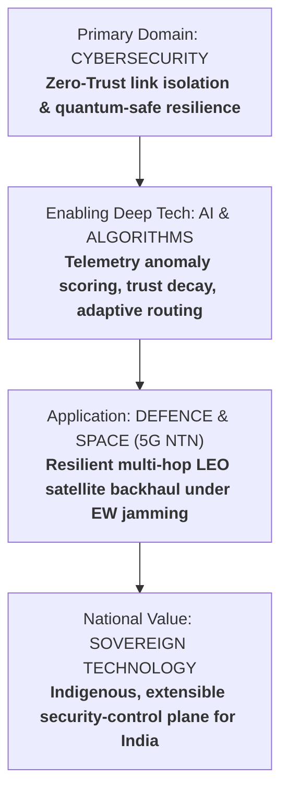
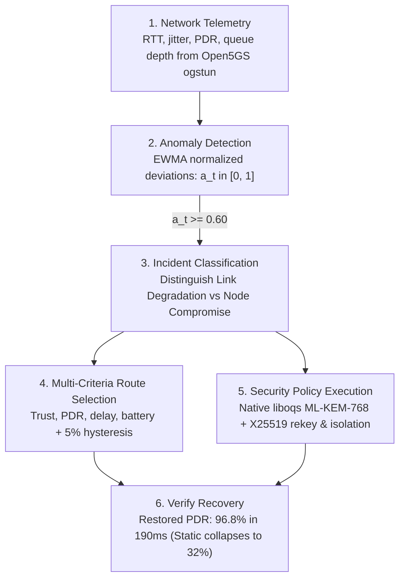

# RAKSHA-NET: Jury Defense, Strategic Positioning & Novelty Guide

> **Target Venue:** TechGig / TOI Ideas for India 2026 | PDPM IIITDM Jabalpur  
> **Track:** Defense & Strategic Technologies / AI & Deep Tech / Indigenous Technology Sovereignty  
> **Official Prototype:** Quantum-Resilient Cybersecurity & Autonomous Recovery for 5G/NTN Networks

---

## 1. Unified Strategic Positioning (The One Coherent Story)

Do not present five disconnected domains. Lead with **Cybersecurity for Strategic Communications**, powered by **Deep Tech**, applied to **5G/NTN Satellite Networks**, delivering **National Technology Sovereignty**.

- **Primary Domain — Cybersecurity:**  
  Protects strategic communications against jammed or compromised nodes, coordinating zero-trust decisions directly with network availability recovery.
- **Enabling Technology — Deep Tech:**  
  Telemetry-driven anomaly detection (EWMA / GraphSAGE), Bayesian trust updates, multi-criteria route optimization, and native hybrid post-quantum cryptography (`liboqs` ML-KEM-768 + X25519).
- **Application — Defence & Satellite Communications (5G NTN):**  
  Tested across a dynamic 5G Non-Terrestrial Network topology with low-Earth-orbit satellite relays under simulated electronic warfare (EW) jamming.
- **National Value — Technology Sovereignty:**  
  Validates an extensible, sovereign security-control layer for Indian telecom and tactical defense infrastructure, aligning with Atmanirbhar Bharat strategic goals.

---

## 2. Novelty Claim & Prior Art Defensibility

### Recent Literature to Be Aware Of:
- **Scientific Reports (Oct 2026):** *"An adaptive behavioural zero-trust security framework with proactive cryptographic caching for continuous authentication in 5G non-terrestrial networks"* (uses telemetry trust assessment, Isolation Forest, and proactive crypto caching for NTN).
- **arXiv (March 2026):** Migration of ML-KEM-768 and ML-DSA into a `free5GC` core via a sidecar proxy.

### What NOT to Claim:
- ❌ Do **not** claim to be the first in the world to combine AI, PQC, zero-trust, and NTN security.
- ❌ Do **not** claim to have invented a new cryptographic algorithm or mathematical primitive.
- ❌ Do **not** claim RAKSHA-NET is already in orbit on Indian military satellites.

### The Bulletproof Novelty Statement to Give the Jury:

> **"A container-native, coordinated security-and-availability recovery controller for 5G/NTN networks.**  
> RAKSHA-NET links telemetry-based anomaly detection and trust-aware path selection with a hybrid post-quantum security response. Rather than treating routing resilience and cryptographic operations as disconnected problems, RAKSHA-NET demonstrates how their **coordinated execution** preserves continuous communication during electronic warfare attacks.  
> 
> **Core Architectural Novelty & Practical Contribution:**
> 1. **Coordinated Availability & Security:** Sub-200ms route failover coupled with sub-millisecond NIST ML-KEM-768 rekeying and node quarantine.
> 2. **Software-Defined, Container-Native Security (Docker CNF):** The entire multi-hop LEO constellation and 5G core run as isolated Docker microservices with dedicated Linux network namespaces. This provides **sandboxed blast-radius containment** (preventing lateral movement if a satellite link is compromised) and **eliminates foreign proprietary hardware lock-in**, enabling deployment on any tactical x86/ARM compute payload."*

---

### Key Security Outcomes of Software/Docker Implementation

| Security Dimension | Traditional Defense Hardware | RAKSHA-NET (Software / Docker Implemented) |
| :--- | :--- | :--- |
| **Blast Radius Containment** | Shared physical chassis; link breach risks lateral system compromise. | **Strict Container Sandboxing:** Each satellite node (`LEO1`, `LEO2`) runs in isolated Linux namespaces; compromise cannot breach the host OS or alternate nodes. |
| **Supply Chain Sovereignty** | Proprietary foreign ASICs & cryptographic black-boxes with hidden backdoors. | **100% Software-Defined:** Runs on open standards (NIST FIPS 203, Open5GS, 3GPP Rel-17) deployable on indigenous x86 or ARM satellite OBCs. |
| **Dynamic Quarantine** | Physical power-down or slow manual network reconfiguration. | **Sub-Second Programmatic Isolation:** Controller dynamically evicts, throttles, or tears down compromised container interfaces via kernel `tc netem` & routing policies. |
| **Deployment Agility** | Months of hardware provisioning and testing. | **Instant Orchestration:** Complete tactical satellite testbed spins up in seconds via `docker compose` or Kubernetes CNF sidecars. |

## 3. End-to-End Decision Framework (The 6 Steps)

### Step 1 — Monitor the Network
Continuously stream telemetry from the live Open5GS-connected core (`ogstun`) and satellite topology:
- Round-trip latency ($\tau$) and jitter ($\sigma_\tau$).
- Packet delivery ratio ($\text{PDR}$) and loss.
- Queue depth ($q$) and path availability.

### Step 2 — Detect Anomalous Behaviour
Compute the normalized deviation from the baseline exponentially weighted moving average (EWMA):
$$a_t = \operatorname{clip}\left(w_\tau d_\tau + w_\ell (1 - \text{PDR}) + w_q d_q,\ 0,\ 1\right)$$
- Threshold $a \ge 0.60$ is our calibrated experimental trigger for electronic warfare degradation.

### Step 3 — Update Trust & Classify Incident
Trust decays dynamically:
$$T_{t+1} = \alpha T_t + (1 - \alpha)(1 - a_t)$$
- **Crucial Engineering Distinction:** Maintain separation between **Link Health** (RF path degradation/loss) and **Node Trust** (malicious compromise, unauthorized tampering, or identity failure).

### Step 4 — Select the Route
Candidate routes are ranked using multi-criteria utility:
$$U(P) = w_T T(P) + w_L \left(1 - \frac{\tau(P)}{\tau_{\max}}\right) + w_P \text{PDR}(P) + w_E E(P)$$
- **Flapping Prevention:** A failover is executed only if candidate path utility exceeds the active path by $\ge 5\%$ hysteresis margin ($\epsilon = 0.05$).
- **Future Extension:** Integrate handshake establishment cost: $U_{\text{secure}}(P) = U(P) - w_H H(P)$ where $H(P)$ incorporates handshake time and retransmission probability.

### Step 5 — Coordinate the Security Action
Response is adapted dynamically to the threat type:
- **RF Jamming / Severe Loss alone:** Autonomous failover to backup satellite $R2$ in $<200\text{ ms}$.
- **Node Tampering / Cryptographic Threat:** Isolate the compromised satellite link and invoke native `liboqs` hybrid **X25519 + ML-KEM-768** to establish a forward-secret session in **$0.56 - 0.71\text{ ms}$**.
- **Compound Electronic Warfare Attack:** Coordinated simultaneous failover + post-quantum session rekeying.

### Step 6 — Verify Recovery
Measure end-to-end service availability:
- **PDR:** Restores to **$96.8\%$** ($+64.5\%$ gain over static routing).
- **Mean Route Recovery Time:** **$190\text{ ms}$** ($\pm 30\text{ ms}$, $100\%$ switch success).
- **Rekey Speed:** **$0.568\text{ ms}$** execution via real C `liboqs-python`.

---

## 4. Prior Art Comparison Matrix (Defense Slide)

| Existing Research Direction | What Is Already Established | RAKSHA-NET's Concrete Distinction |
| :--- | :--- | :--- |
| **PQC Migration in 5G Cores** | PQC can be added to core architectures via sidecar proxies without rewriting NFs (*arXiv 2026*). | We link live core-connected security operations directly to **dynamic route failover** in an active Open5GS testbed. |
| **Behavioural Zero Trust for NTN** | Telemetry trust scoring and adaptive crypto have been modeled conceptually (*Scientific Reports 2026*). | We provide a **working, open implementation** combining Open5GS, live `tc netem` RF degradation, and sub-200ms failover. |
| **Satellite Security Frameworks** | PQC, trust scoring, and anomaly detection exist as theoretical proposals (*MDPI 2025*). | We provide **empirically measured recovery metrics** showing how coordination preserves throughput during active EW attacks. |
| **Conventional Static Routing** | Fixed routes fail to adapt when links are jammed. | We measure and statistically prove the gain: **$96.8\%$ vs $32.3\%$ PDR** ($t = 98.8, p = 5.6 \times 10^{-15}$). |

---

## 5. Script: What to Say When a Judge Asks, *"What is novel here?"*

> *"Our contribution is not a new cryptographic algorithm. RAKSHA-NET addresses a systems-level challenge: **how to maintain operational communications when a network path becomes degraded and a node becomes untrustworthy.**  
>
> We integrate telemetry-based anomaly detection, trust-aware route selection, autonomous failover, and hybrid post-quantum key establishment within a coordinated controller connected to a live Open5GS 5G Core.  
>
> **Crucially, our architecture is 100% software-defined and Docker container-native:**  
> - Each satellite relay and network function executes in an **isolated Linux network namespace**, creating an air-gapped sandbox that prevents lateral attack movement if a satellite link is compromised.  
> - It **eliminates foreign proprietary hardware lock-in**, allowing indigenous deployment on any tactical ARM/x86 onboard computer.  
>
> In our controlled electronic warfare scenario, static routing collapses to 32.3% packet delivery. RAKSHA-NET senses the degradation, fails over to a healthy satellite in 190 milliseconds, restores delivery to 96.8%, and rekeys the session using NIST ML-KEM-768 in 0.57 milliseconds.  
>
> Our contribution is the **container-native implementation, integration, and verified sub-second recovery performance** of this coordinated workflow."*

---

## 6. Pre-Jury Execution Checklist

1. **Lead with Cybersecurity:** Frame the problem as protecting battlefield communication survivability.
2. **Honesty on Implementation:**
   - 5G Core (`open5gs` 16 daemons + `ogstun`): **100% Real software.**
   - Cryptography (`liboqs` ML-KEM-768): **100% Real native C.**
   - RF Channels & Satellite Orbits: **Emulated via Linux `tc netem` & statistical models.**
3. **Live Demonstration Ready:**
   - Terminal: `wsl -d Ubuntu-24.04 python3 -m scripts.run_open5gs_demo`
   - Dashboard: `python -m streamlit run dashboard/app.py` at `http://localhost:8501`
   - Test Suite: `wsl -d Ubuntu-24.04 python3 -m pytest tests/ -q` (53/53 Passing)
